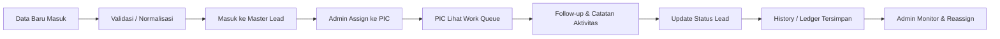

# Internal Data Ops Blueprint

## Tujuan
Sistem internal ini dibangun untuk mengganti kerja manual pengelolaan data kelolaan, distribusi PIC, dan pelacakan follow-up.

Fokus utamanya:
- data masuk terpusat
- pembagian data ke sales/marketing terkontrol
- setiap pembagian dan follow-up punya history
- admin bisa audit, reassign, dan lihat performa operasional
- PIC hanya melihat pekerjaan yang memang ditugaskan ke mereka

## Problem Yang Diselesaikan
- Data tersebar dan sulit dilacak.
- Follow-up dilakukan manual tanpa ledger yang rapi.
- Sulit tahu siapa memegang data, kapan dibagikan, dan apa hasilnya.
- Admin terlalu banyak kerja operasional manual.
- Laporan hanya hasil akhir, tidak ada jejak proses.

## Prinsip Desain
- Satu lead punya satu identitas utama.
- Satu lead bisa punya banyak assignment dan banyak follow-up.
- Semua perubahan penting harus tercatat sebagai history, bukan overwrite tanpa jejak.
- Admin fokus kontrol, PIC fokus eksekusi.
- Sistem harus tetap berguna walau tanpa integrasi WhatsApp atau automation.

## Alur End-to-End

## Role Dan Tanggung Jawab

### Admin
- input atau import lead
- validasi data
- assign lead ke PIC
- pindahkan lead antar PIC
- lihat history assignment dan follow-up
- monitor status pipeline
- lihat dashboard operasional
- audit aktivitas tim

### Marketing / Sales
- lihat lead yang ditugaskan
- update status follow-up
- tambah catatan aktivitas
- tandai hasil follow-up
- lihat histori pekerjaan sendiri

## Data Model Inti

### `leads`
Tabel utama untuk data prospek.

Field minimal:
- `id`
- `source`
- `name`
- `phone`
- `email`
- `location`
- `status`
- `assigned_to`
- `created_at`
- `updated_at`

### `lead_assignments`
Riwayat pembagian lead ke PIC.

Field minimal:
- `id`
- `lead_id`
- `from_user_id`
- `to_user_id`
- `reason`
- `assigned_at`
- `released_at`

### `lead_followups`
Log aktivitas follow-up.

Field minimal:
- `id`
- `lead_id`
- `user_id`
- `activity_type`
- `activity_note`
- `result_status`
- `next_follow_up_at`
- `created_at`

### `lead_status_history`
Jejak perubahan status.

Field minimal:
- `id`
- `lead_id`
- `old_status`
- `new_status`
- `changed_by`
- `changed_at`
- `note`

### `lead_sources`
Master sumber data.

Contoh:
- `new_download`
- `manual_input`
- `import`
- `campaign`

### `lead_ledgers`
Tabel ringkas untuk audit kejadian penting.

Isi:
- assignment
- reassign
- status change
- note
- close
- reopen

### `users`
User internal untuk admin, sales, marketing, supervisor.

### `teams`
Opsional untuk grouping PIC berdasarkan divisi atau cabang.

## Status Lead
Status inti yang disarankan:
- `new`
- `queued`
- `assigned`
- `contacted`
- `follow_up`
- `qualified`
- `won`
- `lost`
- `reassigned`
- `closed`

Status harus bisa dipakai untuk dashboard dan pipeline, bukan sekadar label.

## Aturan Ledger
- Setiap assignment membuat record baru.
- Setiap follow-up membuat record baru.
- Setiap perubahan status membuat record baru.
- Data lama tidak boleh hilang saat status berubah.
- Admin bisa melihat urutan kejadian per lead.

## Scope MVP V1

### Wajib
- login role-based
- master lead
- assignment ke PIC
- work queue PIC
- follow-up logging
- status history
- admin dashboard
- PIC dashboard
- audit trail sederhana

### Belum Perlu
- WhatsApp integration
- automation rules kompleks
- KPI advanced
- referral/commercial module
- omnichannel inbox
- approval bertingkat

## Output Yang Harus Dipakai Tim Dev
- schema tabel inti
- API endpoint untuk lead, assignment, follow-up, status
- dashboard admin
- dashboard PIC
- ledger/history view

## Non-Goal Fase Awal
- tidak mengejar integrasi WA dulu
- tidak mengejar workflow komersial kompleks dulu
- tidak meniru struktur Google Sheet
- tidak membuat UI terlalu banyak page sebelum flow inti selesai

## Definisi Sukses
Sistem dianggap berhasil jika:
- data baru masuk tanpa manual sheet
- admin bisa assign dan reassign dengan jelas
- PIC bisa kerja dari daftar tugas sendiri
- semua activity bisa diaudit
- status pipeline bisa dipantau real time
- laporan operasional bisa diambil dari sistem, bukan rekap manual

